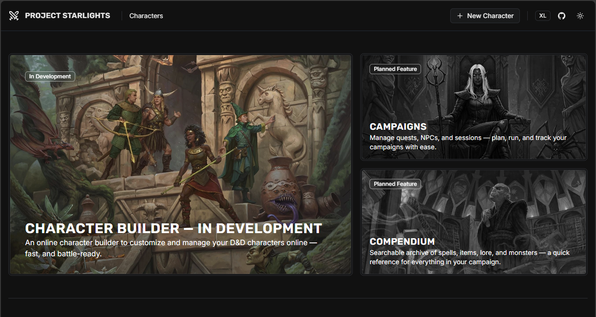

# Project Starlights

This is a work-in-progress project intended as an online toolset to enhance tabletop role‑playing games. Its initial focus is creating characters for Dungeons & Dragons in the form of an online version of [Aurora](https://www.aurorabuilder.com), which was my original creation years ago.

If you'd like to see this project grow, please consider giving it a star :star: — thank you!

There is no public-facing website hosted for this project at this time, and more details will be shared as development progresses.

<hr />

_A screenshot from the experimental Development UI in this project._



## Running Locally

This project uses .NET Aspire for local orchestration. You can run it using Visual Studio or the command line.

### Prerequisites

- .NET 11 SDK (version selected by `global.json`)
- Node.js 20.19+
- Docker Desktop (or compatible container runtime)
- Visual Studio (recent version) or Visual Studio Code

Deployment machines must meet .NET 11's CPU requirements: x86-64-v2 on x64, or LSE support on Windows Arm64.

### Using Visual Studio

1. Open `Starlights.slnx` in Visual Studio.
2. Ensure `Starlights.AppHost` is set as the startup project with `https` as the launch profile.
3. Press **F5** to start debugging.

Once running, the Aspire Dashboard will launch automatically. From there, you can access the frontend application, backend API, and Scalar API documentation.

### Using Aspire CLI

To run the application using the Aspire CLI (see [aspire.dev](https://aspire.dev)), execute the following command in the root directory:

```bash
aspire run
```

This will start the AppHost, which orchestrates:

- **SQL Server**: A container (port `61070`)
- **Migrations**: Automatically applies EF Core migrations
- **Backend API**: The .NET Web API
- **Frontend**: The React/Vite application
- **Dashboard**: The Aspire dashboard for logs and metrics

### Initial Setup

Aspire applies the Identity, Elements and Characters migrations before starting the API. Provision an account before opening the builder; there is no public registration or account-administration API.

From a private operator terminal, supply the SQL Server connection string for the same database used by Aspire through `ConnectionStrings__starlights-db` (or an operator-managed configuration provider). Do not commit credentials or pass passwords as command arguments:

```powershell
${env:ConnectionStrings__starlights-db} = "<operator-connection-string>"
dotnet run --project src\apps\Starlights.Application --no-launch-profile -- accounts create <username>
dotnet run --project src\apps\Starlights.Application --no-launch-profile -- accounts reset-password <username>
dotnet run --project src\apps\Starlights.Application --no-launch-profile -- accounts disable <username>
dotnet run --project src\apps\Starlights.Application --no-launch-profile -- accounts enable <username>
```

Create and reset prompt for the password twice without echoing it; redirected password input is rejected. Passwords must satisfy ASP.NET Core Identity's default password policy. Accounts require a unique username, but no email or profile.

Sign in through the builder. Sessions have an eight-hour inactivity timeout and no remember-me option. Application restarts preserve valid sessions; sign-out revokes only the current session, while password reset and disabling revoke every account session by the next API request. Re-enabling requires a new sign-in. Keep the database, its persisted authentication keys and its backups private to the application and authorized operators.

The retained Character routes now require sign-in and enforce owner isolation, including lists and nested selections. The ownership migration leaves pre-existing ownerless development Characters inaccessible rather than assigning them to an arbitrary account. Reset disposable development data if needed; new Characters receive the authenticated user's stable GUID. This is a security adapter for the retained model, not the target Character redesign.

To initialize sample content, use the authenticated `POST /api/elements/initialize` request in [Identity.http](src/apps/Starlights.Application/Identity.http) after signing in and obtaining a fresh antiforgery token. Initialization is no longer a state-changing GET or an anonymous Aspire dashboard action.

### Frontend Dependencies

Install frontend dependencies from `src/frontend` using `npm ci`; the root lockfile covers all npm workspaces. Run `npm run build` there to build the shared packages and applications.

The frontend uses TypeScript 7 and Oxlint. Run `npm run lint` from `src/frontend` to lint every application and shared package, or use `npm run lint -w <workspace>` for one workspace. All workspaces use the shared `src/frontend/.oxlintrc.json` configuration.

Oxlint's native rules cover JavaScript/TypeScript checks, Rules of Hooks, Hook dependencies, and Fast Refresh exports. React Compiler-specific diagnostics from eslint-plugin-react-hooks are not included; this setup does not use ESLint or JavaScript lint plugins.

Browser API calls use relative `/api` paths, same-origin cookies and fresh antiforgery tokens for writes. Vite resolves its backend proxy from `VITE_API_BASE` or Aspire service discovery; the standalone fallback is `http://localhost:5240`. Production hosting must expose UI and API under one HTTPS origin. Only loopback development may use plain HTTP.

With the development API running, regenerate the typed client contracts from `src/frontend`:

```powershell
npm run generate -w @starlights/api-client -- http://localhost:5240/openapi/v1.json
```

Use the API's actual HTTP address when Aspire assigns a different port. Generation covers the new Identity and retained legacy routes; the typed client is used by sign-in/session/sign-out, while retained consumers use the secured legacy adapter. The pinned generator runs with its own TypeScript 5 peer via `npm exec`, isolated from the application's TypeScript 7. Commit regenerated contracts alongside endpoint changes. [Identity.http](src/apps/Starlights.Application/Identity.http) demonstrates token, sign-in, session and sign-out requests.

Identity and generated contracts are the first F00 increment, not completion of the platform foundation. Private blob storage/emulator integration and its owner-isolation checks remain next; the target Character-builder journey is still later work.

## Running Tests

You can run the automated test suite using Visual Studio or the command line.

### Using Visual Studio 2026

1. Open the **Test Explorer** window (**Test** > **Test Explorer**).
2. Click the **Run All Tests** button (or press **Ctrl+R, A**).

### Using CLI

To run all tests, execute the following command in the root directory:

```bash
dotnet test
```

## Architecture

The project follows a **Modular Monolith** architecture, organized by business capability:

- **Elements Module**: Manages game data (classes, abilities, features, rules).
- **Characters Module**: Handles character creation and management.
- **Identity Module**: Owns local accounts, credentials, durable cookie sessions and shared authenticated-user integration.
- **Platform Layer**: Provides shared infrastructure (hosting, logging, data, eventing).

Each module is self-contained with its own domain logic, data persistence, and API endpoints.

## Acknowledgements

This project builds on my experience developing [Aurora](https://www.aurorabuilder.com), a character builder for Windows.

## License

This project is being developed in the open under the [MIT License](./LICENSE).
