# Starlights UI design: the "Eclipse" landing page (v4)

Status: the approved visual direction for the Starlights landing page, and the reference for the look of the rest of the web UI. Read this before changing the landing page or designing a new page, and follow [the frontend guidance](../src/frontend/AGENTS.md) for where code belongs.

The reference implementation is `src/frontend/apps/landing-page/src/variants/v4/` (route `/v4` in the landing-page app). `v0` to `v3` are earlier explorations kept for comparison; **v4 is the one to build from**.

| Dark (home theme) | Light |
| --- | --- |
| 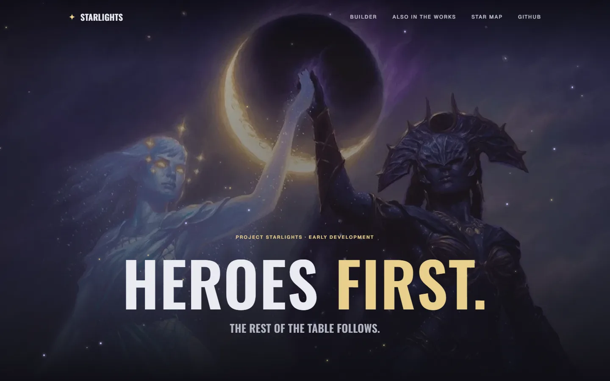 |  |

## Contents

1. [Design intent](#design-intent)
2. [Colour](#colour)
3. [Typography](#typography)
4. [Layout and spacing](#layout-and-spacing)
5. [Page structure](#page-structure)
6. [The star map (roadmap constellation)](#the-star-map-roadmap-constellation)
7. [Motion](#motion)
8. [Imagery](#imagery)
9. [Light theme](#light-theme)
10. [Responsive behaviour](#responsive-behaviour)
11. [Accessibility](#accessibility)
12. [Do and don't](#do-and-dont)
13. [Where things live](#where-things-live)
14. [Moving this into the builder app](#moving-this-into-the-builder-app)
15. [The builder shell (v5 mockup)](#the-builder-shell-v5-mockup)
16. [Reference-build editor](#reference-build-editor)

## Design intent

Starlights is a calm, premium, fantasy tool. The page should feel like a quiet night sky above a game table, not a loud marketing page.

- **Calm over flashy.** Near-neutral charcoal, one soft gold accent, restrained motion. Colour comes from the artwork, not from the interface.
- **The builder is the focus.** The Character Builder leads; campaigns, the compendium, homebrew and other rulesets are shown honestly as later stars.
- **Honest status.** Only the builder is in development. Everything else is "Planned", "Exploring" or "Daydream", and the copy never promises it.
- **Fantasy, not costume.** Fantasy comes from the art, the uppercase condensed headings and the star motif. Avoid faux-medieval fonts, parchment textures and ornament in this direction.
- **Clean.** Generous whitespace, thin rules, no cards-in-cards, no gradients on text, no glow soup.

## Colour

All colour comes from seven tokens, defined per theme under the `.v4` root in `v4.css` and written in OKLCH. Never hard-code a colour in a component: use a token (via the Tailwind aliases below) or `color-mix()` of tokens.

### Dark (home theme)

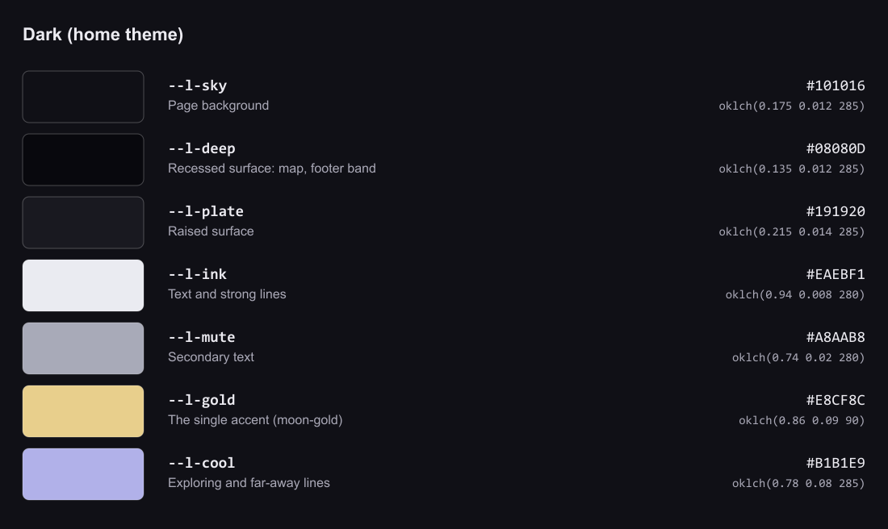

### Light

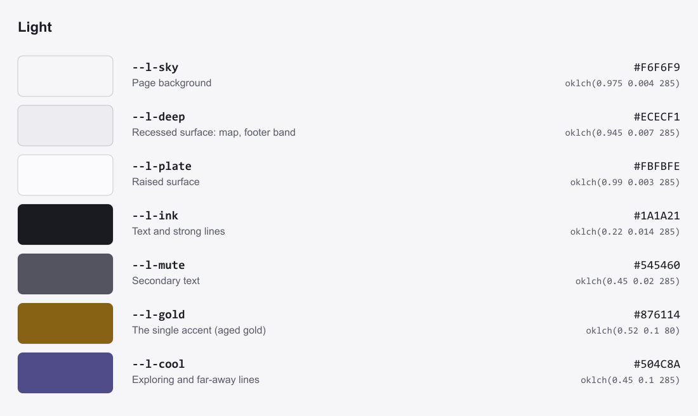

### Token reference

| Token | Tailwind alias | Role |
| --- | --- | --- |
| `--l-sky` | `bg-sky` | Page background |
| `--l-deep` | `bg-deep` | Recessed surface: the map frame, the closing band |
| `--l-plate` | `bg-plate` | Raised surface |
| `--l-ink` | `text-ink` | Primary text, strong lines, "Planned" stars |
| `--l-mute` | `text-mute` | Secondary text, hints, "Daydream" stars |
| `--l-rule` | `border-rule` | Hairlines: section dividers, frames |
| `--l-gold` | `text-gold`, `bg-gold` | **The single accent.** Eyebrows, key words in headings, primary buttons, the "In development" star |
| `--l-cool` | (CSS only) | Cool lilac-blue for "Exploring" stars and dotted lines toward unconfirmed goals |
| `--l-on-gold` | (CSS only) | Text colour placed on a gold fill |
| `--l-dots` | (CSS only) | Opacity multiplier for the starfield: 0.85 dark, 0.3 light |

Rules:

- **Gold is the only accent.** Use it for at most one phrase per heading, the eyebrow, and the primary action. Do not add a second accent colour.
- **Cool lilac-blue is reserved** for the star map's "Exploring" state and the dotted far lines. It is not a general UI colour.
- Status colour mapping (used by the legend and the map; see `statusColor` in `src/data/content.ts`):

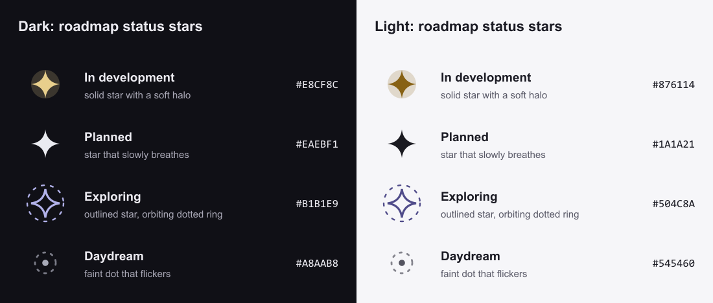

### Contrast (WCAG, computed from the tokens)

| Pair | Dark | Light |
| --- | --- | --- |
| `ink` on `sky` | 15.9 | 16.0 |
| `mute` on `sky` | 8.2 | 6.9 |
| `mute` on `deep` | 8.7 | 6.3 |
| `gold` on `sky` | 12.4 | 5.2 |
| `gold` on `deep` | 13.1 | 4.8 |
| `cool` on `deep` | 9.8 | 6.5 |
| Button label on gold fill | 12.3 | 5.4 |

All pairs meet AA (4.5:1) for body text. The lowest is gold on the light recessed surface (4.8:1): keep gold text on `deep` at 14px bold or larger, or move it to `sky`.

### Scrims over artwork

Text over images uses black or near-black gradients rather than a flat overlay: bottom-up `sky` to transparent on the hero, with a short top gradient behind the header. The hero scrim is always the **dark** sky colour, in both themes (see [Light theme](#light-theme)).

## Typography

Two families, both variable, self-hosted via Fontsource (`@fontsource-variable/oswald`, `@fontsource-variable/geist`, imported in the app's `index.css`).

| Use | Family | Weight | Case |
| --- | --- | --- | --- |
| Headings, brand name, node names, buttons' tone | **Oswald** | 600 (500 for small list headings) | **UPPERCASE** |
| Body, UI text, descriptions | **Geist** | 400 to 600 | Sentence case |

Oswald is the same face used by the base landing page (v0), so this keeps brand continuity. **All headings are uppercase** (the `.display` class applies `text-transform: uppercase`, `letter-spacing: 0.015em` and `line-height: 1`).

### Scale

| Element | Class / value |
| --- | --- |
| Hero heading ("Heroes first.") | `.display`, `clamp(3.5rem, 11vw, 9rem)`, line-height 0.92, `tracking-tight` |
| Hero subline | `.display`, `clamp(1rem, 2.3vw, 1.6rem)`, weight 400, `tracking-[0.16em]`, `text-mute` |
| Section heading (builder) | `.display`, `clamp(2.5rem, 5vw, 4rem)`, line-height 0.98 |
| Section heading (star map) | `.display`, `clamp(2.5rem, 5.5vw, 4.5rem)`, line-height 0.98 |
| Row title (Campaign Ledger, Compendium) | `.display`, `text-4xl sm:text-5xl` |
| Closing heading | `.display`, `clamp(2.25rem, 4.5vw, 3.5rem)`, line-height 1.02 |
| Feature list title | `.display`, `text-lg`, weight 500, `tracking-wider` |
| Brand name | `.display`, `text-xl`, `tracking-[0.28em]` |
| Body copy | Geist, `leading-relaxed`, `text-mute` (`max-w-md` to `max-w-xl`) |
| Small copy | `text-sm`, `text-mute` |

### Eyebrow (small label above headings)

`.eyebrow`: 11px (0.6875rem), weight 600, `letter-spacing: 0.2em`, uppercase, gold (or `mute` for status labels). One per section, sitting above the heading.

### Nav and buttons

- Nav links: 12px, weight 500, `tracking-[0.16em]`, uppercase, `ink` at 80%, gold on hover.
- Buttons (`.btn-solid`, `.btn-line`): 13px, weight 600, `letter-spacing: 0.14em`, uppercase, `rounded-sm`, `px-6 py-3.5`.
  - `.btn-solid`: gold fill, `--l-on-gold` label. The primary action ("Meet the builder" / "Open the builder").
  - `.btn-line`: 1px gold border, gold label, fills with gold on hover. Secondary action ("Star it on GitHub").

### Highlighting a phrase

Two-tone headings: first clause in `ink`, second clause in gold, on separate lines (`<span className="block text-gold">`). One highlighted clause per heading, never a gradient.

## Layout and spacing

- **Container:** `mx-auto w-full max-w-[1180px] px-5 sm:px-8`.
- **Section rhythm:** `py-24 sm:py-32` between major sections. Sections are separated by a 1px `border-rule` line, not by background changes, except the closing band which uses `bg-deep`.
- **Grid:** 12 columns from `lg`. Builder section is 5 / 7. Planned rows are 7 / 5, alternating sides.
- **Radius:** `rounded-sm` throughout (images, buttons, frames). The page is crisp, not soft.
- **Frames:** 1px `border-rule` hairlines. No drop-shadows except on the small overlapping scene photo.
- **Images are never side by side in a row of three.** Each image gets its own space (see below). This was an explicit requirement.

## Page structure

Top to bottom:

1. **Header** (absolute over the hero): star mark + `STARLIGHTS` (tracking 0.28em) left; nav right (`Builder`, `Also in the works`, `Star map`, `GitHub`). Hidden below `md`.
2. **Hero** (100svh, dark island): the eclipse artwork full-bleed, falling stardust, centred copy: eyebrow, `HEROES FIRST.` (second word gold), subline `THE REST OF THE TABLE FOLLOWS.` **No paragraph and no buttons** in the hero by request; the header is centred text only.
3. **Builder** (the focus): left column 5/12 with eyebrow, two-tone heading, intro paragraph, four ruled feature points, primary button and a status line. Right column 7/12 with the large builder artwork (4:3) and a small overlapping "scene" photo (miniature and dice) at its lower left (`sm:-bottom-12 sm:-left-12`, width 16rem, 4px `sky` border). **No character-sheet image** here: the sheet is not the focus.
4. **Also in the works:** a heading, then one full-width row per planned tool (Campaign Ledger, Compendium), each a 16:9 image (7/12) with eyebrow, title and blurb (5/12), alternating sides, separated by hairlines.
5. **Star map:** centred heading and intro, then the map (see next section).
6. **Closing band** (`bg-deep`): star mark, heading with a gold clause, one sentence, `.btn-line` to GitHub.
7. **Footer:** brand, the variant switcher, the prototype-art note, the trademark note.

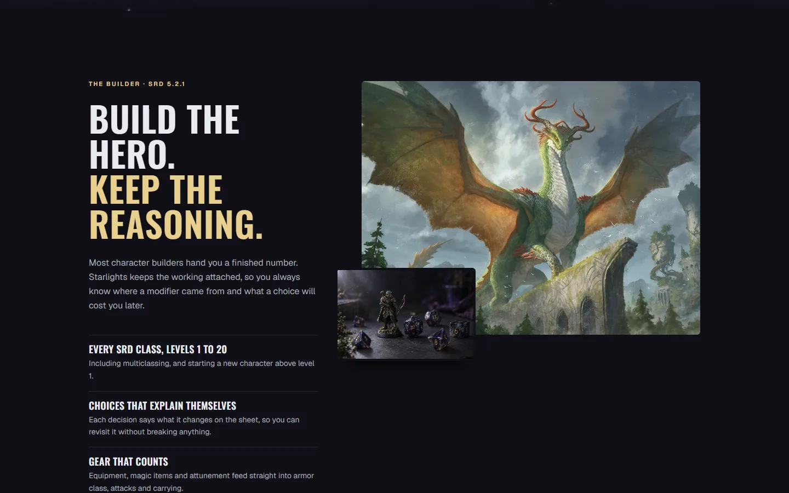

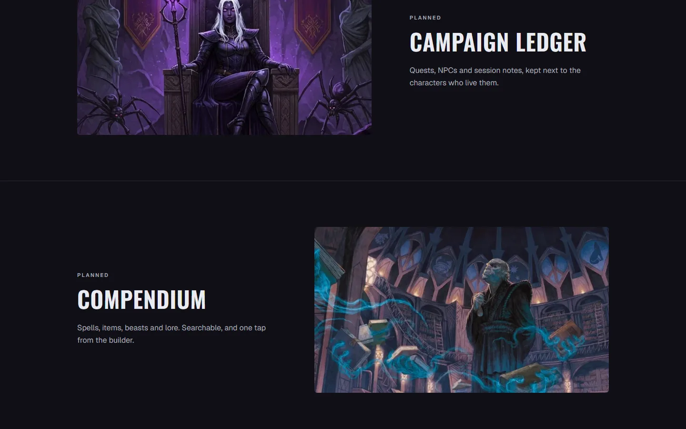

## The star map (roadmap constellation)

The roadmap is an interactive constellation. This concept is fixed; layout and styling may vary between pages, but the behaviour below must be kept. Implementation: `variants/sky.tsx` (generic) with `variants/armillary.tsx` and `variants/armillary-layout.ts` (the Eclipse look).

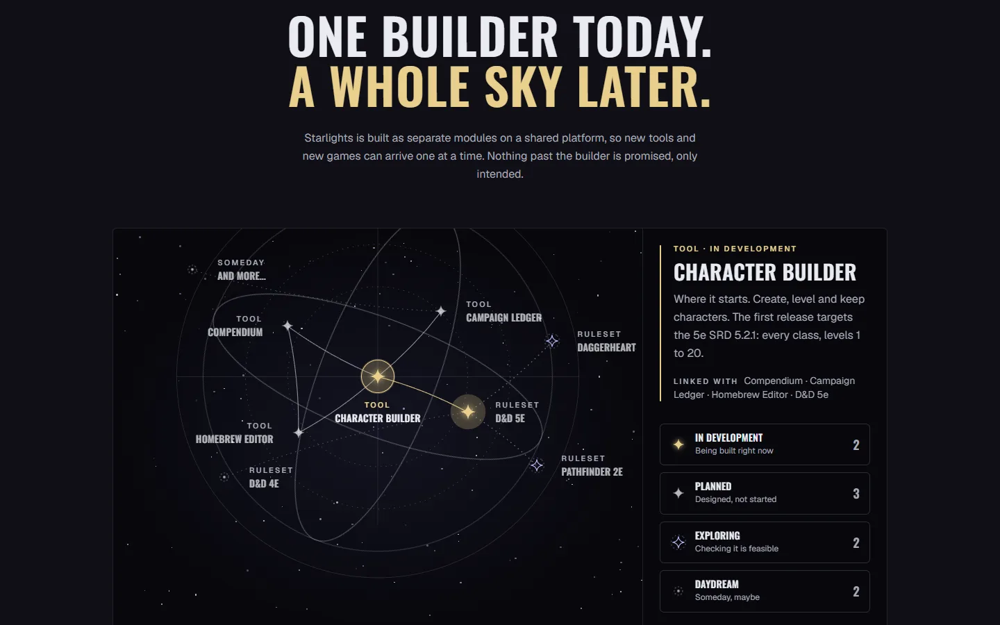

### Composition

- An **armillary**: thin concentric rings and three great-circle ellipses drawn behind the stars. The outer great-circle group rotates once per 240s (`.spin-slow`). Rings: strokes in `currentColor` (`ink`) at 12 to 50% opacity, the inner rings dotted (`2 8`).
- A soft radial "nebula" glow centred on the builder, from the `--v4-nebula` token (0.5 alpha indigo in dark, 0.2 in light).
- A starfield (`Starfield`, 140 stars, fixed seed so it is identical every render) behind everything.
- **Layout** (percent of a 1000 x 560 view): the builder at the pole (50, 50); tools on the inner ring (Compendium, Campaign Ledger, Homebrew Editor); D&D 5e close to the builder; Daggerheart, Pathfinder 2e and D&D 4e on the outer ring; "And more..." far in a corner.
- Node names use `.display` at `0.8rem`/`sm`, weight 500, `tracking-[0.1em]`, with a small `Tool` / `Ruleset` / `Someday` eyebrow above.

### Nodes and lines

| Status | Star | Animation |
| --- | --- | --- |
| In development | Solid gold four-point star with a soft halo | Halo pulse, 3.2s |
| Planned | Solid `ink` star | Gentle breathing, 4.5s |
| Exploring | Outlined cool star with an orbiting dotted ring | Ring rotates, 16s |
| Daydream | Faint `mute` dot with a dotted ring | Slow flicker, 5s |

- Lines between built or planned stars: straight, 1.5px; gold at 90% when both ends are "In development", otherwise `ink` at 55%. They **draw in** (stroke-dashoffset, 1.5s, staggered) the first time the map scrolls into view.
- Lines toward Exploring and Daydream goals: **dotted** (`2 7`), 1.3px, cool, fainter for Daydream (40%) than Exploring (70%). They fade in after the solid lines.
- **No aurora ribbons, no glow streaks, no shooting star** on the map. Those were tried and removed.
- **No decorative captions** such as "Sector 01" or "Not to scale".

### Interaction

- Hover, focus or click a node to select it. The selected node gets a ring in its status colour; its name turns `ink`.
- Selecting a node shows its detail (eyebrow, title, summary, "Linked with") in the side panel.
- The **legend** has four status buttons (hover or focus previews; click pins). A status dims every other node and line to 16% opacity. Each shows its count.
- Layout: from `xl` (1280px) the map is `1fr` with a `22rem` sidebar holding detail then the legend (single column). Below `xl` they sit under the map. Below `md` the map is replaced by a plain grouped list (Tools, Rulesets, Someday) with the legend above it.

### Two rules that must not regress

1. **No layout jitter.** Every node's detail is rendered in the same grid cell (`DetailStack`) and only the selected one is visible, so the panel is always as tall as the longest entry. Selecting different stars must never change page height. (Verified: 9 selections, constant page and frame height.)
2. **The SVG layer must not capture clicks.** The decorative SVG has `pointer-events-none`; the node buttons sit above it (`z-10`). Otherwise stars respond to hover but not click.

## Motion

Minimal and slow. One entrance per element, then stillness except for the sky itself. Everything respects `prefers-reduced-motion: reduce` (animations off, final states shown).

| Effect | Spec |
| --- | --- |
| Entrance (`.rise`) | Fade and rise 16px, 800ms, `cubic-bezier(0.2, 0.7, 0.2, 1)`, staggered by 80 to 120ms |
| Hero image settle | Scale 1.05 to 1, 1400ms |
| Scroll reveal (`.reveal`) | Fade and rise once, when 15% visible, 800ms; stays revealed |
| Hover on buttons | Colour/brightness only, 200 to 250ms |
| Node hover | Scale 1.25, 300ms (motion-safe only) |
| Map line draw-in | 1500ms per line, staggered 140ms |
| Dim on legend | Opacity 400ms |

### Falling stardust (hero)

The signature effect, replacing the embers of the Hearth variant. 46 specks (`.dust`) fall from above the hero to below it:

- Size 1.5 to 3.9px (similar to the embers), round, with a soft 6px glow in their own colour.
- Colours: warm white (`oklch(0.96 0.02 90)`, twice as common), soft gold (`oklch(0.88 0.09 90)`), pale lilac (`oklch(0.84 0.08 285)`).
- Opacity 0.45 to 0.96 per particle; fade in over the first 12% and out over the last 12% of the fall.
- Duration 13 to 25s each, linear; negative delays so the sky is already populated on load; sideways drift of up to 36px.
- Positions and parameters are deterministic (index-derived), so it looks the same on each render.
- Hidden entirely under `prefers-reduced-motion`.

## Imagery

The art carries the colour; the interface stays neutral. Images are WebP files in `src/frontend/apps/landing-page/public/images/`, converted from the originals (long edge about 1000 to 1800px, quality 78 to 86).

| Slot | File | Source |
| --- | --- | --- |
| Hero background | `shar-hero.webp` | Selune and Shar eclipse painting, a personal reference image supplied for local prototyping (see Provenance) |
| Builder (large) | `builder-dragon.webp` | Builder-app artwork (green dragon on a mossy arch) |
| Builder (small scene) | `scene-dice.webp` | Generated: painted ranger miniature among indigo and gold dice |
| Campaign Ledger row | `builder-drow.webp` | Builder-app artwork (drow sorceress on a throne) |
| Compendium row | `builder-compendium.webp` | Builder-app artwork (robed scholar, spectral books) |

Direction for any new art:

- Painterly high-fantasy (D&D sourcebook feel), dark and moody, **muted or desaturated**; accents of indigo, violet, teal or gold are fine, vivid purple/pink is not.
- Crops: hero `object-position: 50% 28%`; builder image `48% 30%`; rows 16:9.
- Always meaningful `alt` text describing the scene. Hero image `fetchPriority="high"`; all others `loading="lazy"`.
- A small overlapping "scene" photo (miniature, dice) evokes play; do not use a filled character sheet as the hero of the builder section.

**Provenance.** The prototype contains AI-generated images, images from the builder prototype and a personal reference image. The footer says so. **None of it is cleared for publication**; replace or license each image before the site goes public.

## Light theme

Light mode is the same page "printed on cool paper": identical layout, spacing, type and motion; only the tokens change. Dark remains the home theme (`ThemeProvider defaultTheme="dark"`), and the shared `D` key and the persisted `theme` value still apply.

| Dark | Light |
| --- | --- |
|  | 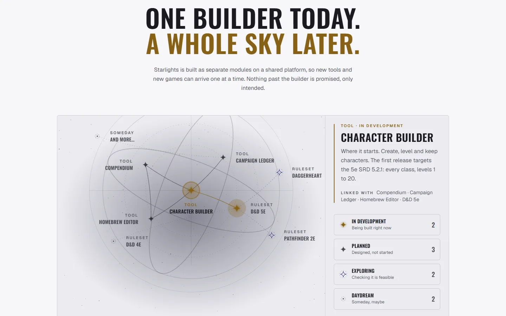 |
|  | 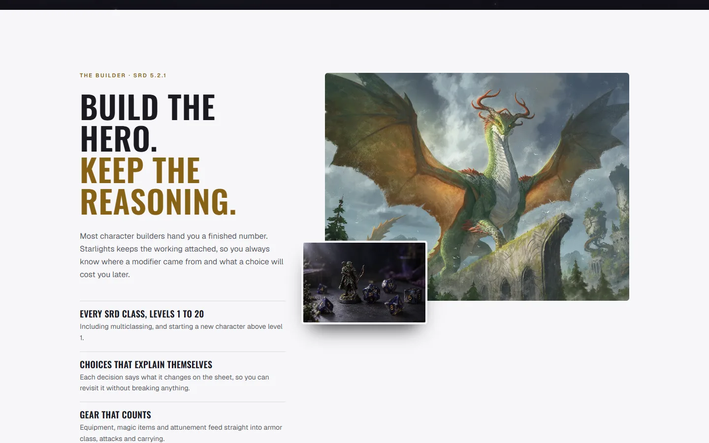 |
|  | 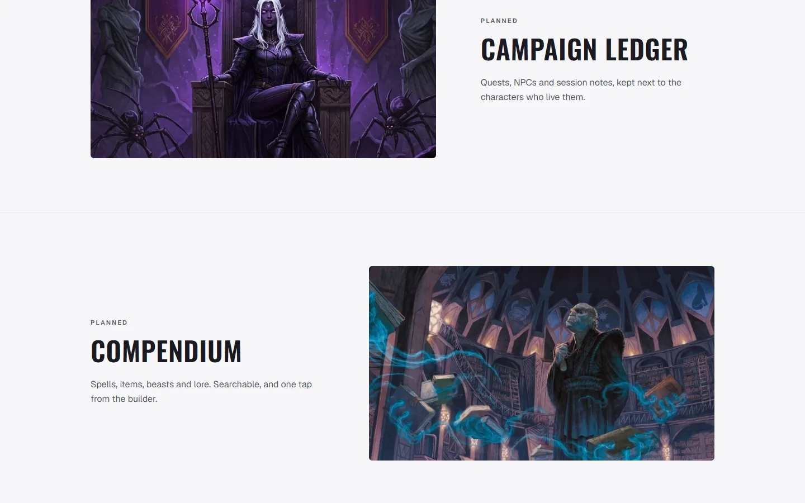 |
| 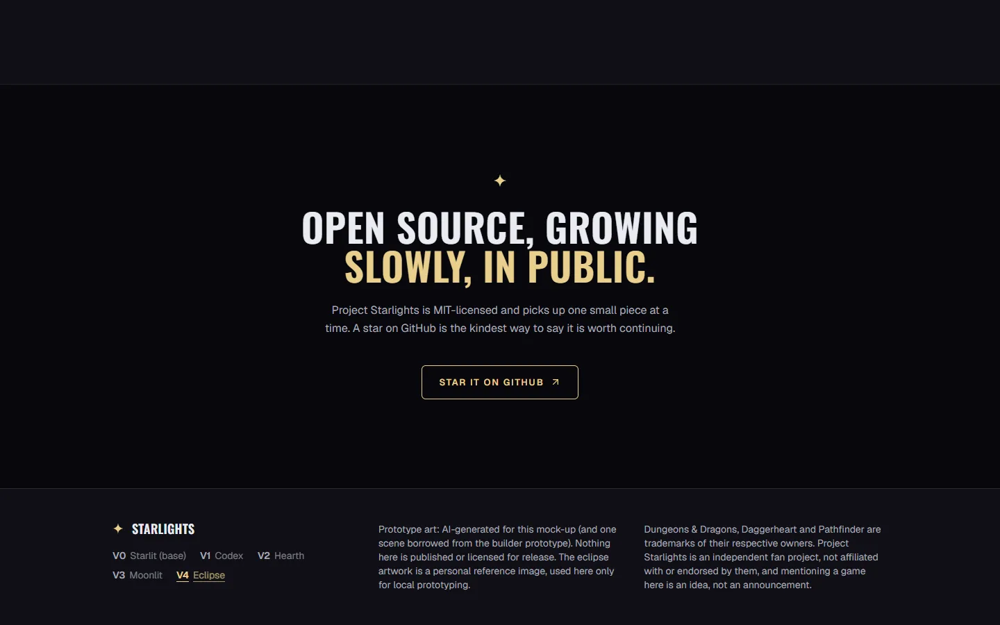 | 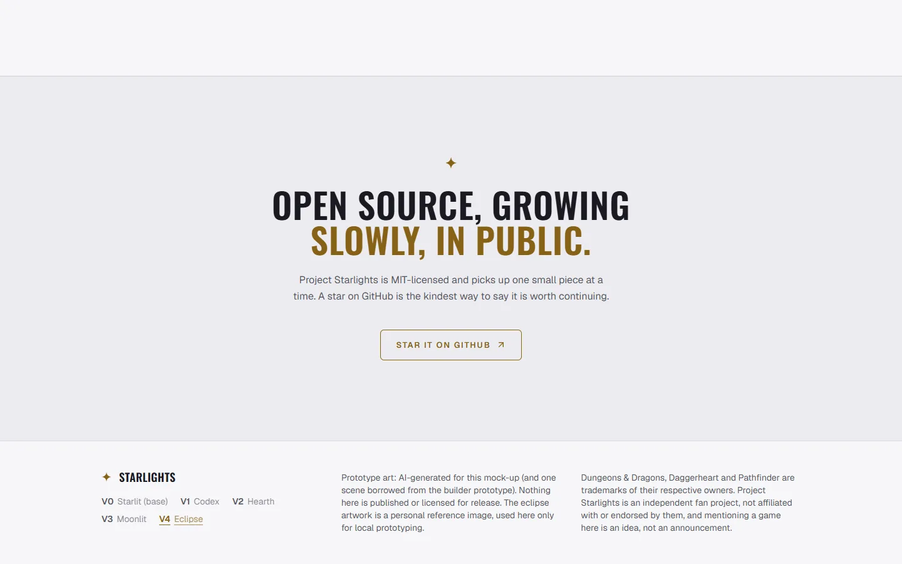 |

Differences to know:

- **The hero and header are a permanent dark island** (`.on-dark`). The eclipse art is dark in both themes, so everything on top of it uses the dark tokens (light text, soft gold, dark scrim). In light mode the page therefore opens with the dark hero and then turns to paper below it.
- **Gold darkens** from `oklch(0.86 0.09 90)` to `oklch(0.52 0.10 80)` (aged gold) so it holds 5:1 on paper; the label on a solid gold button flips to near-white (`--l-on-gold`).
- **Stars and lines invert**: `ink` is near-black, so planned stars, node names and links read dark on paper. The cool colour deepens to indigo (`oklch(0.45 0.1 285)`).
- **Starfield dims** (`--l-dots` 0.3) so specks read as faint paper grain rather than stars; the nebula glow is a pale indigo (0.2 alpha).
- **Dark surfaces get lighter steps**: `deep` is a slightly darker paper, `plate` a brighter one.

## Responsive behaviour

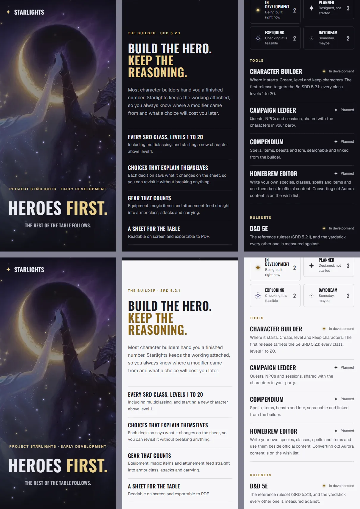

- Header nav hides below `md`; the brand stays.
- Hero heading scales with `clamp()`; the hero stays 100svh and centred.
- Builder: columns stack below `lg`; the small scene photo moves under the large image (it only overlaps from `sm`).
- Planned rows stack below `lg`, image first.
- Star map: full map from `md`; sidebar beside the map from `xl`; below `md` a grouped list with the same status icons and the legend above it.
- Touch targets: nodes have 12px of padding around the glyph; buttons are at least 44px tall.

## Accessibility

- Every node is a real `<button>` with `aria-pressed` and a label such as "Daggerheart, ruleset, exploring". Status is conveyed by shape, text and label, never by colour alone.
- Focus: `a:focus-visible, button:focus-visible` get a 2px gold outline with 3px offset.
- Contrast is AA or better in both themes (table above).
- All motion respects `prefers-reduced-motion`. Decorative layers (`dust`, starfield, SVG rings) are `aria-hidden`.
- Headings follow order: `h1` hero, `h2` per section, `h3` for rows and feature points.
- The map's detail panel is not an `aria-live` region (hover would otherwise announce constantly). The currently selected node's detail is always visible text.
- Known limit: the single-key `D` theme shortcut comes from the shared `ThemeProvider` (WCAG 2.1.4); changing that is a shared decision.

## Do and don't

**Do**

- Keep headings uppercase Oswald and body in Geist.
- Use one gold accent and let the artwork supply colour.
- Give every image its own space; alternate image and text sides.
- Keep the star map as the roadmap and keep its status vocabulary.
- Keep motion slow and rare; provide the reduced-motion path.
- State status honestly ("In development", "Planned", "Exploring", "Daydream").

**Don't** (each of these was tried and rejected)

- Purple or pink gradients, bright accent colours, glows on text or UI.
- Aurora ribbons or streaks on the map, shooting stars, "Sector 01" or "Not to scale" captions.
- A filled character-sheet image as the focus of the builder section.
- Three images side by side as equal tiles.
- A paragraph and buttons crammed into the hero; it is a centred heading only.
- Faux-medieval fonts, parchment textures or ornate frames (these belong to the v1 exploration).
- Decorative "story" copy that implies features are shipped.

## Where things live

```
src/frontend/apps/landing-page/
  index.html                      title, description, favicon
  public/images/                  WebP art (see Imagery); unused/ holds spare generated art
  src/main.tsx                    picks the page by URL (/, /v1 ... /v4)
  src/index.css                   shared keyframes, v0 tokens (do not add v4 tokens here)
  src/data/content.ts             node and tile data, status labels/colours, builder link
  src/components/                 v0 components; glyphs.tsx (StarMark, StatusGlyph), starfield.tsx, reveal.tsx
  src/variants/
    motion.css                    keyframes consumers: rise, reveal, twinkle, halo, breathe, flicker, orbit, dust
    copy.ts                       shared copy (feature points, prototype-art and trademark notes)
    sky.tsx                       the generic, parameterised constellation (+ Legend, DetailStack, mobile list)
    armillary.tsx                 decorative rings for the Eclipse map
    armillary-layout.ts           node positions for the Eclipse map
    variant-list.ts, variant-links.tsx   footer switcher (v0 to v5)
    v4/v4.css                     the Eclipse tokens, .display, .eyebrow, buttons, .on-dark (also applies to v5)
    v4/V4.tsx                     the page
    v5/                           the builder-shell mockup (see the last section)
```

Content data (`content.ts`): `nodes` (id, kind, name, status, summary), `links` (pairs), `tiles` (builder, campaigns, compendium), `statusLabel`, `statusHint`, `statusColor`, and `builderHref`/`builderCta` (the CTA reads "Meet the builder" and scrolls to the section until `VITE_BUILDER_URL` is set, then reads "Open the builder" and links there).

## Moving this into the builder app

The landing page is a mock-up in its own app. When porting:

1. **Tokens.** The seven tokens are scoped to `.v4`/`.dark .v4`. The v0 page re-points the shadcn variables (`--background`, `--foreground`, `--primary`, ...) onto its tokens so `ui-framework` components match; **v4 does not yet do this**. Add the same mapping (`--background: var(--l-sky)`, `--foreground: var(--l-ink)`, `--muted-foreground: var(--l-mute)`, `--border: var(--l-rule)`, `--primary: var(--l-gold)`, `--primary-foreground: var(--l-on-gold)`, `--ring: var(--l-gold)`) when shared components appear inside the page.
2. **Fonts.** Load Oswald and Geist through the shared package, not per app.
3. **Shared pieces.** `Sky`, `StatusGlyph`, `Starfield`, `Reveal` and the falling-dust CSS are generic and are candidates for `packages/ui-framework`, per [the frontend guidance](../src/frontend/AGENTS.md): promote them only when a second app needs them.
4. **Theme.** Use the shared `ThemeProvider` and `useTheme`; do not add another toggle.
5. **Images.** Replace the placeholders and uncleared art (see Provenance) before publishing.
6. **Behaviour to preserve:** no jitter, click-through fix, reduced-motion path, the dark hero island.

## The builder shell (v5 mockup)

`/v5` in the landing-page app is a clickable mockup of how the **character builder** should look and behave, built from the same tokens, type and motion rules as the landing page. All data is mock; the build itself is the roadmap's reference character (Human Fighter, Soldier) so its numbers match [the first checkpoint](./BEHAVIOR.md#first-checkpoint-human-fighter-soldier): armor class 17, hit points 12, initiative +4, greatsword +5 for 2d6 + 3 with Graze, 18 GP. Code: `src/frontend/apps/landing-page/src/variants/v5/`.

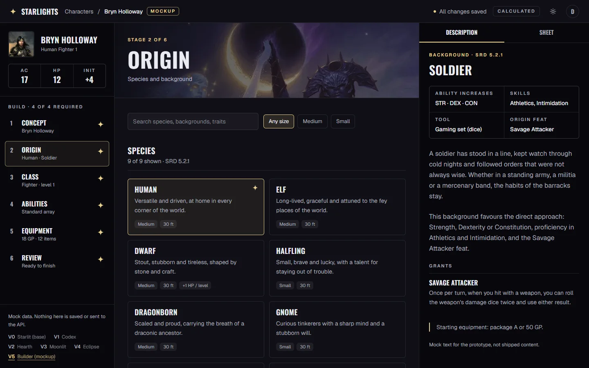

### Anatomy

Three columns at `xl` (1280px and up), each scrolling on its own; the page itself never scrolls.

| Region | Width | Contents |
| --- | --- | --- |
| Top bar | full, 56px | Brand, breadcrumb (`Characters / Name`), a `Mockup` tag, autosave status (`Saving…` then `All changes saved`), a `Calculated` pill, theme toggle, account mark |
| Stage navigation | 17.5rem, left | Character card (portrait, name, species and class, AC / HP / Init), the six stages with a status mark and a one-line detail, a "Kept for later" box, mock-data note and the variant switcher |
| Work area | flexible, centre | A dark banner (the eclipse art, always dark) with the stage number, heading and hint, then the stage content, then Back / Next |
| Detail panel | 26rem, right | Tabs: **Description** and **Sheet** |

Below `xl` the stage navigation becomes a horizontal tab strip under the top bar. Below `lg` the detail panel stacks under the work area.

### Stages

The guided flow from the roadmap (F04): **Concept, Origin, Class, Abilities, Equipment, Review.**

| Stage | What it shows |
| --- | --- |
| Concept | Name (required), portrait picker, optional notes, read-only ruleset (game, pinned content, campaign) |
| Origin | Search and size filter; species and background cards; the choices each one asks for (species skill and feat, +2/+1 ability increases, languages); conflicts; "Kept for later" |
| Class | Class roster (Fighter available, the rest marked "Later"); level locked to 1; two skills, a Fighting Style, three weapon masteries |
| Abilities | Standard array, point buy (27 points, 8 to 15, live budget) or saved rolls; table of base, origin increase, score and modifier |
| Equipment | Fighter and background packages: choose A or B, then **claim**; possessions with Wear / Wield; a "Why armor class N?" box |
| Review | Checklist with a jump to each stage, conflict list, `Finish build` (enabled only when complete), `Export PDF` (planned, disabled) |

Ability generation starts with editable assignments: standard array uses its
authored order, application rolls use their displayed roll order, and point buy
starts every ability at 8. Allocation follows the displayed ability order,
without guessing a class-specific priority. Confirmed method changes and rerolls
replace assignments with these starting values; physical dice starts blank.
Confirmation copy explains the replacement. Reopening preserves saved inputs.

### The description panel

Hovering or focusing any option (species, background, style, mastery, ability, class) previews it in the **Description** tab without choosing it; choosing pins it. With nothing in focus the panel explains the current stage. A description is: gold eyebrow (`Species · SRD 5.2.1`), an uppercase Oswald title, a fact grid, paragraphs, a ruled **Grants** list and an optional gold-ruled note. It always ends with "Mock text for the prototype, not shipped content."

### The sheet panel

The **Sheet** tab is the live, recalculated sheet: six ability tiles (modifier large, score and its breakdown beneath, e.g. `17 (15+2)`), stat tiles for armor class, hit points, initiative, speed, proficiency and passive Perception, saving throws, all 18 skills with a proficiency dot, attacks, features and feats, and equipment with currency. Each stat tile shows **where the number came from** (`Chain mail 16 + Defense +1`, `10 + CON +2`, `DEX +2 · Alert +2`). This is the "shows its work" promise applied to the sheet.

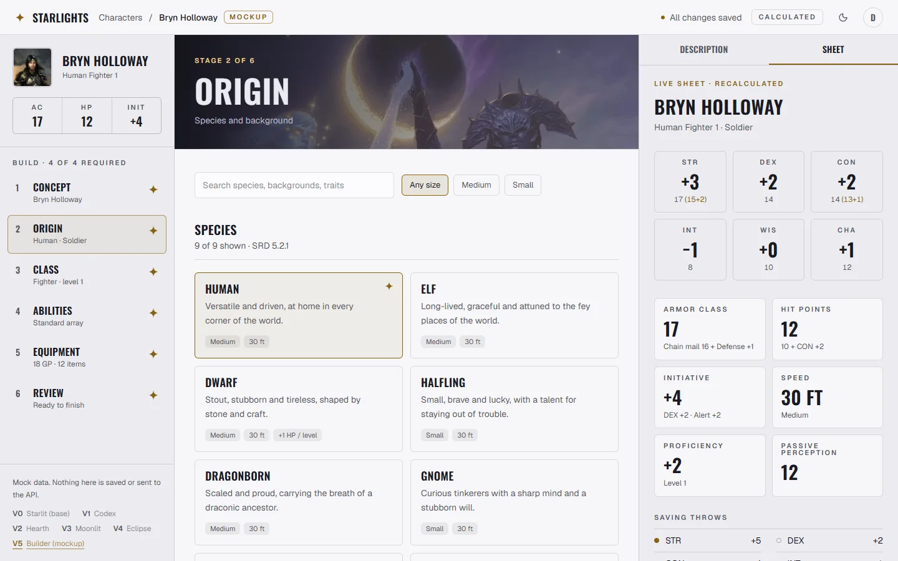

### Behaviours the mockup demonstrates

These come straight from the roadmap and must survive the real implementation:

- **Everything recalculates from state.** Change the background, species, scores, style or equipment and the sheet, the nav card and every stage's status update immediately.
- **Choosing is not owning.** A starting-equipment package is chosen, then separately **claimed**; claimed packages cannot be silently re-picked. Owning armor is separate from wearing it (taking the chain mail off drops armor class from 17 to 12).
- **Nothing is lost when you change your mind.** Choices made for a species or background that is no longer selected are kept and listed under **Kept for later**; switching back restores them.
- **Conflicts are explained where they were caused and where they are fixed.** For example, picking Acolyte (Insight) while the Fighter already chose Insight raises a conflict on both Origin and Class, with a "Fix in Class" link; choosing Criminal (Alert) next to the Human's Versatile Alert reports the duplicate feat.
- **Completion is honest.** Four stages are required; Equipment is optional and never blocks the build; the nav shows what is missing in gold.
- **Scores keep their sources.** Base, origin increase and total are always separate columns, and rolled results are saved and never silently rerolled.
- **Unsupported things say so.** Other classes show "Later"; levels 2 to 20 are locked with their roadmap slice; PDF export is disabled and labelled planned.

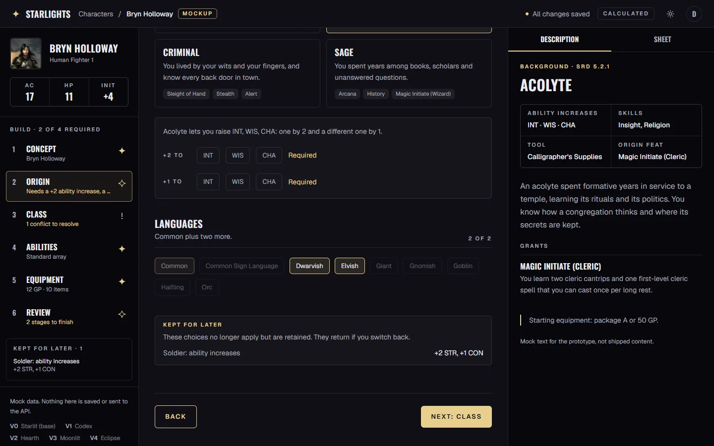

### Controls and states

- **Option card:** 1px `rule` border; hover `ink` at 35%; selected is a gold border, a 7% gold wash and a small gold star in the corner.
- **Chip:** `rounded-sm`, 13px; selected is a gold border with a 12% gold wash; a dashed gold border marks a conflicting choice; disabled is 45% opacity.
- **Stage status mark:** filled gold star = complete, outlined star = still to do, dashed ring = optional, `!` = conflict.
- **Fields:** `plate` fill, `rule` border, gold border on focus; native `select` with a custom chevron.
- **Notices:** `Conflict` and `Kept for later` boxes share one shape: 1px border (gold at 60% for warnings), a gold uppercase eyebrow, muted body text.
- **Buttons:** `.btn-solid` for the single primary action in view, `.btn-line` for secondary; both uppercase with 0.14em tracking.

### Responsive

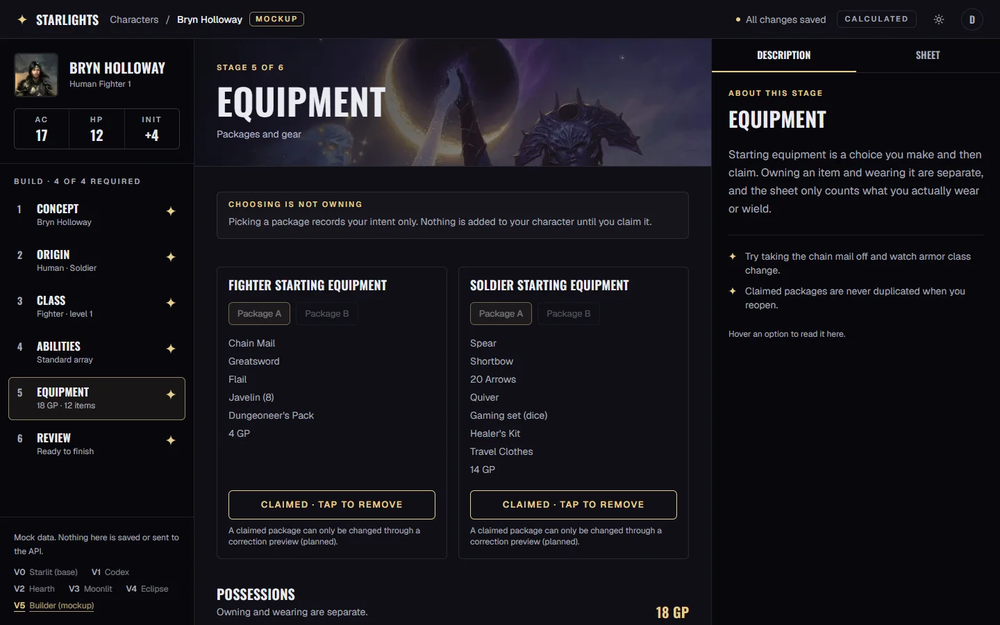

- `xl` and up: three columns as described.
- `lg` to `xl`: stage tabs on top, work area and detail panel side by side (24rem panel).
- Below `lg`: one column: stage tabs, work area, then the detail panel. On touch screens the description appears below the options; hover previews do not exist there, so choosing pins the description.

### Light theme

The shell uses the same tokens, so light mode needs no special cases. The stage banner is a permanent dark island (like the landing hero), and the rest of the app turns to paper.

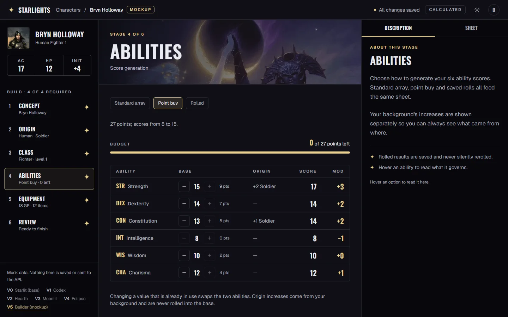

### Known limits of the mockup

- Only Fighter and the four SRD backgrounds are wired to rules; other species have traits as text, with only Human, Elf and Dwarf affecting numbers.
- Level is fixed at 1; multiclassing, spells and magic items are out of scope.
- Autosave is simulated; nothing is stored or sent anywhere.
- Rules text is paraphrased placeholder copy, not the SRD.

## Reference-build editor

The bounded reference-build editor uses the existing Character workshop shell
and shared UI components. It is not the full six-stage F04 navigation or the v5
mockup. Work and the saved sheet sit side by side on wide screens and stack on
smaller screens. Existing theme tokens, the shared theme toggle and restrained
cards remain unchanged.

- Name and content-provided decisions autosave after a short pause. A later
  keystroke remains visible while an earlier save finishes.
- Ability generation offers standard array, point buy, application rolls and
  physical dice through the shared outline toggle group. Supported values come
  from the server. Method switches and rerolls use an accessible confirmation
  dialog; pending edits must be resolved before replacement.
- Application dice and drop-lowest totals remain visible before allocation.
  Point-buy accounting identifies the saved budget; physical totals explicitly
  identify player-provided results without claiming verified rolls.
- Input, ordinary pre-limit score, maximum, effective score and modifier remain
  separate. Missing required assignments carry explicit fallback and issue
  labels, with expandable source origins. Generation changes unlock assignments
  only after save confirmation. The same cards and tokens stack on mobile.
- Package selection, explicit claiming and wearing/wielding owned items are
  separate controls. Claims are not presented as completed before confirmation.
- Save status, build completion and sheet readiness are separately labelled.
  A sheet beside unsaved input identifies the saved revision it describes.
  Pending or failed calculations do not display an earlier sheet as current.
- Conflict and unconfirmed-save callouts retain the input. Reapplying against
  the latest revision or discarding unsaved input requires an explicit choice;
  an unconfirmed operation is retried with its original identifier.
- Live-update failures are visible, with a reconnect action and HTTP checks of
  saved state. Reconnection reloads authoritative state rather than replaying
  missed notifications.
- Full and concise authored descriptions use Markdown; descriptions do not
  replace missing mechanics or silently supply missing player choices.

## Regenerating the images in this document

The swatch PNGs are computed from the same OKLCH values as `v4.css` (converted to sRGB), and the screenshots are real captures at 1440 x 900 (and 390 x 844 for mobile). If the tokens change, regenerate them so the document does not drift from the CSS. Capture dark and light at 1440px wide: a narrower window stacks the layout and will not match the descriptions above.
